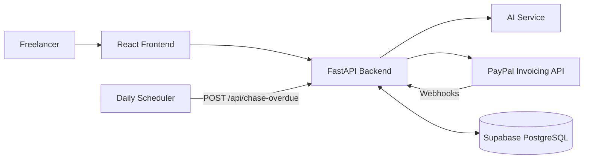

# BahiKhata — The AI Invoicing Assistant

BahiKhata helps freelancers turn client notes into PayPal invoices, track payments, and send AI-assisted payment reminders for overdue invoices.

Built by Anurag Shukla for the PayPal AI Hackathon.

## Features

* **AI-powered invoice creation:** Convert natural-language client notes into structured invoice details.
* **PayPal integration:** Create invoice drafts, send invoices, and issue payment reminders through PayPal.
* **Invoice ledger:** View invoices and track their payment status.
* **Payment tracking:** Process PayPal webhooks to update invoice statuses.
* **AI-assisted reminders:** Generate reminder messages based on how overdue an invoice is.
* **Automated follow-ups:** Chase overdue invoices with reminder limits and configurable intervals.
* **Tax support:** Specify a tax rate and tax label for invoice line items.
* **Responsive interface:** Manage invoices through a React-based web application.

## Architecture



## Technology Stack

| Component              | Technology                                       |
| ---------------------- | ------------------------------------------------ |
| Frontend               | React, Vite, Tailwind CSS                        |
| Invoice ledger         | AG Grid                                          |
| Backend                | Python, FastAPI                                  |
| Database               | Supabase PostgreSQL                              |
| Payments and invoicing | PayPal Invoicing API                             |
| AI                     | AI service configured in the backend             |
| Deployment             | Vercel/Render, depending on the deployed service |

## Project Structure

```text
schema.sql              Supabase database schema
backend/main.py         FastAPI backend
backend/test_main.py    Backend tests
frontend/src/           Frontend application
frontend/ui.test.jsx    Frontend interface tests
render.yaml             Render deployment configuration
```

## Getting Started

### Prerequisites

* Python 3.11 or newer
* Node.js 18 or newer
* A Supabase project
* A PayPal Developer account and sandbox application
* An API key for the AI provider configured in the backend

### 1. Set Up Supabase

1. Create a Supabase project.
2. Open the SQL Editor.
3. Run the project's `schema.sql`.
4. Copy the project URL and the required service key from your Supabase project settings.

Keep service-role credentials private. Never expose them in frontend code or commit them to GitHub.

### 2. Configure PayPal

1. Sign in to the PayPal Developer Dashboard.
2. Create a sandbox application.
3. Copy its client ID and secret.
4. Keep the credentials available for the backend configuration.

### 3. Configure the Backend

Open a terminal at the project root:

```bash
cd backend
python -m venv .venv
```

Activate the virtual environment.

**Windows PowerShell:**

```powershell
.venv\Scripts\Activate.ps1
```

**Linux/macOS:**

```bash
source .venv/bin/activate
```

Install dependencies:

```bash
python -m pip install -r requirements.txt
```

Copy the example environment file:

**Windows PowerShell:**

```powershell
Copy-Item .env.example .env
```

**Linux/macOS:**

```bash
cp .env.example .env
```

Fill in the required variables in `.env`, using the names documented in `backend/.env.example`. These may include the AI API key, Supabase credentials, PayPal sandbox credentials, frontend origin, and cron secret.

Start the backend:

```bash
uvicorn main:app --reload
```

The backend should be available at `http://localhost:8000`.

### 4. Configure the Frontend

Open a second terminal from the project root:

```bash
cd frontend
npm install
npm run dev
```

Open the local development URL printed by Vite, typically `http://localhost:5173`.

Configure the frontend API URL according to the project's environment setup. For local development, ensure requests reach the local FastAPI backend.

### 5. Configure PayPal Webhooks

PayPal requires a publicly accessible webhook endpoint.

1. Deploy the backend or expose the local backend through a secure development tunnel.
2. Register the public endpoint ending in `/webhooks/paypal` in your PayPal sandbox application.
3. Subscribe to the invoice events supported by the backend.
4. Configure the webhook ID in the backend environment variables.

**Security:** Do not disable webhook signature verification in a deployed environment. Any verification bypass should be restricted to controlled local testing.

## Try the Main Workflow

1. Open the application.
2. Enter client notes describing the client, work, prices, tax, and payment deadline.
3. Use the AI parsing feature to populate the invoice form.
4. Review and correct the generated details.
5. Create an invoice draft through PayPal.
6. Send the invoice to a PayPal sandbox buyer.
7. Complete a sandbox payment and check that the invoice status updates.
8. Test payment reminders using an overdue invoice.

For testing automated reminders, use a sandbox invoice and an appropriate test due date. Avoid modifying production invoice records merely to demonstrate the workflow.

## Automatic Overdue Reminders

The backend provides:

`POST /api/chase-overdue`

The scheduler endpoint uses a cron secret for authorization. The implementation supports overdue-invoice selection, reminder limits, escalating reminder tone, and protection against duplicate sends.

To automate this endpoint, configure a trusted scheduler to send a POST request with the required `x-cron-secret` header.

Example:

```bash
curl -X POST \
  -H "x-cron-secret: YOUR_CRON_SECRET" \
  https://YOUR-API-URL/api/chase-overdue
```

Configure the scheduler frequency and reminder settings according to your environment.

## API Endpoints

| Endpoint                           | Purpose                                              |
| ---------------------------------- | ---------------------------------------------------- |
| `POST /api/parse`                  | Convert client notes into structured invoice details |
| `POST /api/invoices`               | Validate and create an invoice                       |
| `POST /api/invoices/{id}/send`     | Send an invoice through PayPal                       |
| `GET /api/invoices`                | Retrieve invoices and their status                   |
| `POST /webhooks/paypal`            | Process PayPal invoice events                        |
| `POST /api/invoices/{id}/followup` | Generate a payment reminder                          |
| `POST /api/invoices/{id}/remind`   | Send a reminder through PayPal                       |
| `POST /api/chase-overdue`          | Process overdue invoices for automated follow-up     |

## Testing

Run the backend tests:

```bash
python -m pytest backend/test_main.py -v
```

Run the frontend tests using the scripts configured in `frontend/package.json`.

The repository includes tests for invoice validation, payment status handling, webhook processing, reminder behavior, tax calculations, and other application workflows.

Test results can vary with environment configuration and mocked integrations. Passing automated tests does not, by itself, establish that every live PayPal, Supabase, and AI integration has been verified.

## Deployment

The frontend and backend can be deployed separately.

Before deployment:

1. Configure the required environment variables in the hosting provider.
2. Set the frontend API URL to the deployed backend.
3. Configure the backend's allowed frontend origins.
4. Register the production webhook URL with the PayPal application.
5. Confirm that webhook signature verification is enabled.
6. Test invoice creation, sending, payment updates, and reminders in the sandbox.

For custom domains, follow the hosting provider's DNS instructions and verify HTTPS before sharing the site.

## Known Limitations

* **Authentication:** If authentication is not enabled, users may be able to access shared application data. Do not use the application for confidential customer data until access controls are implemented and verified.
* **Sandbox payments:** Sandbox credentials are intended for testing. Live transactions require the appropriate live PayPal credentials and configuration.
* **Tax compliance:** Tax labels and rates are invoice inputs. Users remain responsible for determining the tax treatment applicable to their transactions.
* **Legal documents:** Privacy and terms pages should be reviewed before the application is used with real customers.

## AI Disclosure

BahiKhata uses an AI service to interpret natural-language invoice notes and assist with payment-reminder writing. The exact provider and model should match the backend configuration used in the submitted version.

## License

See the repository's `LICENSE` file for the applicable open-source license.
