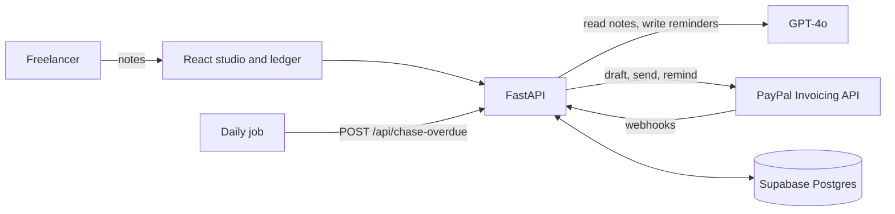

# BahiKhata

The AI invoicing assistant. Paste your client notes and BahiKhata fills in a PayPal invoice, tracks when it is paid, and writes the reminder when it is not.

Built by Anurag Shukla for the PayPal AI Hackathon. React (Vite) and AG Grid on the front, FastAPI on the back, OpenAI GPT-4o, Supabase Postgres, and the PayPal Invoicing API.



## What is in the project

```
schema.sql              Supabase tables
backend/main.py         the whole API
backend/test_main.py    61 backend tests
frontend/src/           landing page, studio, ledger, privacy and terms pages
frontend/ui.test.jsx    17 interface tests
render.yaml             Render blueprint for the API and the website
```

Pages: `/` landing, `/app` studio (notes on the left, live invoice on the right), `/app/ledger` every invoice with Send and Chase, `/privacy`, `/terms`.

## Run it locally

Needs Python 3.11+ and Node 18+.

1. **Supabase**: create a project, open the SQL editor, run `schema.sql`. Copy the project URL and the `service_role` key (Settings, API).
2. **PayPal**: on developer.paypal.com create a sandbox app. Copy the client ID and secret.
3. **Backend**
   ```bash
   cd backend
   python -m venv .venv && source .venv/bin/activate
   pip install -r requirements.txt
   cp .env.example .env        # fill in the keys
   uvicorn main:app --reload
   ```
4. **Frontend** (second terminal)
   ```bash
   cd frontend
   npm install
   npm run dev                 # http://localhost:5173, /api is proxied to :8000
   ```
5. **Webhook**: PayPal needs a public URL. Deploy first (below) or run a tunnel such as `cloudflared tunnel --url http://localhost:8000`. In your sandbox app add a webhook at `https://<public-url>/webhooks/paypal` for the Invoicing events and put its ID in `PAYPAL_WEBHOOK_ID`.

For quick tests with PayPal's webhook simulator (it sends fake signatures) set `SKIP_WEBHOOK_VERIFY=1`. Never leave it on in a deployed environment.

## Try the full flow

1. Open `/app`. Paste notes like `Brand identity for Meera Shah (meera@studiokora.in), 3 days at 8000 a day, plus 2500 for print files. 18% GST, due in 15 days.` and click **Read my notes**. Fix anything it left blank. Watch the invoice on the right.
2. Click **Create draft on PayPal**, then **Send to client**. Use a sandbox personal account's email for the client so you can pay it.
3. Pay it from the sandbox buyer account. The webhook flips the ledger row to Paid.
4. To see chasing without waiting, backdate a sent invoice in the Supabase SQL editor:
   ```sql
   update invoices set due_date = current_date - 10 where invoice_number = '0001';
   ```
   Open `/app/ledger`, click **Chase**, edit the email, click **Send through PayPal**.

PayPal may refuse an invoice created with a due date already in the past, which is why the demo backdates it afterwards.

## GST and IGST

Each line has a tax rate, and the invoice has a tax type label (GST or IGST). The rate is sent to PayPal as that line's tax, and PayPal's own total is stored. BahiKhata does not work out which rate applies to you or split GST into CGST and SGST. Whether PayPal accepts INR invoices depends on your PayPal account, so check that in the sandbox first.

## Automatic chasing

`POST /api/chase-overdue` chases every overdue invoice on its own, oldest first, at most 20 per run. It skips paid and cancelled invoices, stops after 5 reminders per invoice, waits `REMINDER_GAP_DAYS` (default 3) between reminders, and makes each one firmer than the last. It needs the header `x-cron-secret` to match `CRON_SECRET`. Two overlapping runs cannot email the same client twice.

Free scheduler using Supabase (enable `pg_cron` and `pg_net` under Database, Extensions). The timeout matters, because the default is 5 seconds and each reminder involves an AI call:

```sql
select cron.schedule('chase-overdue', '30 3 * * *', $$
  select net.http_post(
    url := 'https://YOUR-API-URL/api/chase-overdue',
    headers := jsonb_build_object('x-cron-secret', 'YOUR_CRON_SECRET'),
    timeout_milliseconds := 60000
  );
$$);
```

Or from any scheduler: `curl -X POST -H "x-cron-secret: $CRON_SECRET" https://YOUR-API-URL/api/chase-overdue`.

## API

| Endpoint | Purpose |
|---|---|
| `POST /api/parse` | notes to structured invoice (GPT-4o JSON mode), numbers and dates cleaned |
| `POST /api/invoices` | validate, create the PayPal draft, store it with PayPal's total |
| `POST /api/invoices/{id}/send` | send the draft through PayPal |
| `GET /api/invoices` | list invoices with `days_overdue` |
| `POST /webhooks/paypal` | signature-verified, idempotent, order-safe status updates |
| `POST /api/invoices/{id}/followup` | GPT-4o writes a reminder (tone follows lateness and reminders sent) |
| `POST /api/invoices/{id}/remind` | send that reminder through PayPal's remind API |
| `POST /api/chase-overdue` | the daily job |

## Deploy on Render

Push to GitHub, create a Blueprint from `render.yaml`, and fill in the variables it asks for. Set `FRONTEND_ORIGIN` to the website's address and `VITE_API_URL` to the API's address. The `routes` rule in `render.yaml` makes `/app`, `/privacy` and `/terms` work on refresh. The free tier sleeps when idle, so the first request after a pause is slow; PayPal retries webhooks that time out.

## Custom domain

1. Buy the domain from any registrar.
2. In Render, open the `bahikhata-web` service, Settings, Custom Domains, and add `yourdomain.com` and `www.yourdomain.com`.
3. At your registrar add the DNS records Render shows. Usually a `CNAME` for `www` pointing at `bahikhata-web.onrender.com`, and an `ALIAS`/`ANAME` (or the `A` record Render lists) for the bare domain.
4. Wait for Render to issue the HTTPS certificate, then set `FRONTEND_ORIGIN` on the API to `https://yourdomain.com,https://www.yourdomain.com` and redeploy.
5. Optional: give the API its own address such as `api.yourdomain.com` the same way, then point `VITE_API_URL` at it.

## Tests

```bash
cd backend && pip install pytest && pytest test_main.py      # 61 tests
cd frontend && npm test                                       # 17 tests
```

These run against in-memory stand-ins for Supabase, PayPal and OpenAI. They cover idempotent and out-of-order webhooks, one-shot sends and reminders, failure rollbacks, tone escalation, reminder caps, cron auth, GST totals, and every page and flow in the interface. The built site was also loaded in a real browser at desktop and phone sizes with no console errors or overflow. Nothing has been run against the live PayPal, Supabase or OpenAI yet, so the first sandbox run is the real integration test.

## Known limits

- **No login.** Anyone who knows the address can use the site, and every invoice appears in the same ledger. That is fine for a sandbox demo. Add Supabase Auth and per-user rows before real client data goes through it.
- **Sandbox by default.** For live money set `PAYPAL_BASE_URL` to `https://api-m.paypal.com` and use live credentials.
- **Reminders are PayPal emails.** The AI text appears inside PayPal's reminder, which adds the pay button.
- **Legal pages are drafts.** The Privacy Policy and Terms describe how the app really works, but have a lawyer review them before real customers use it.
