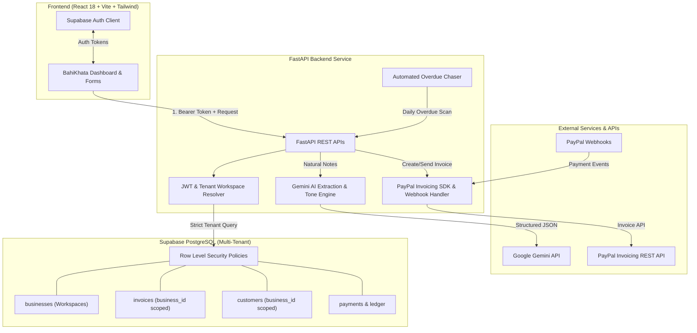

# 📒 BahiKhata — The AI Invoicing Assistant
> **Turn client notes into professional PayPal invoices in seconds. Track payments in real-time. Follow up automatically.**

[](https://developer.paypal.com/)
[](https://fastapi.tiangolo.com)
[](https://react.dev)
[](https://supabase.com)
[](https://ai.google.dev)
[](LICENSE)

---

Welcome judges! **BahiKhata** (*traditional Indian ledger / bookkeeping record*) solves a massive friction point for freelancers, solo consultants, and SMBs: **spending hours manually writing invoices, chasing late payments, and reconciling payment statuses.**

### 🎯 2-Minute Feature Walkthrough
1. **Instant Demo Login:** Click the **"Demo Login"** button on the sign-in screen to enter an already-populated business workspace with active invoices, payment history, and overdue records.
2. **AI Natural Language Invoicing:**
   - Go to **Create Invoice**.
   - Paste a messy client brief such as:
     > *"Brand identity & design sprint for Maya Rao (maya@studiokora.design). 4 days at 7500 per day, plus 3000 for font licenses. 18% GST, due in 10 days."*
   - Click **"Parse with AI"**. Gemini extracts structured line items, customer details, tax rates, and due dates in seconds.
3. **1-Click PayPal Dispatch:** Review the generated draft and hit **"Send with PayPal"**. BahiKhata communicates directly with the **PayPal Invoicing API**, creates the invoice draft, generates a secure payment link, and emails it to the client.
4. **Real-Time Webhook Reconciliation:** When a payment is made or cancelled, the **PayPal Webhook Engine** automatically updates invoice status to `PAID`, records transaction logs in the ledger, and stops further reminder sequences.
5. **Smart Overdue Follow-ups:** Open an overdue invoice and generate an **AI Follow-up**. The AI dynamically alters its communication tone based on lateness:
   - **3–7 days overdue:** Polite, friendly reminder.
   - **8–21 days overdue:** Firm, direct follow-up with balance reminder.
   - **22+ days overdue:** Formal, professional demand for settlement.
6. **Multi-Tenant Workspace & GSTIN Support:** Sign up as a brand-new user to experience the zero-data first-time onboarding flow, optional GSTIN validation, and strict database-level Row Level Security (RLS).

---

## 🌟 Key Features

| Capability | Description |
| :--- | :--- |
| **🧠 AI Invoice Extraction** | Converts unstructured text notes, emails, and WhatsApp summaries into structured line items, quantities, rates, and tax calculations using **Google Gemini**. |
| **💳 Deep PayPal Invoicing** | Full end-to-end integration with the **PayPal Invoicing API (v2)** for draft creation, dispatch, and hosted payment links. |
| **🔄 Real-Time Webhook Engine** | Processes incoming PayPal invoice webhooks (`INVOICING.INVOICE.PAID`, `CANCELLED`, `REFUNDED`) with cryptographic signature validation. |
| **📊 Interactive Financial Ledger** | Centralized dashboard powered by high-performance data grids for sorting, filtering, and tracking real-time accounts receivable. |
| **🤖 Autonomous Chasing Engine** | Automated cron endpoint (`POST /api/chase-overdue`) that evaluates overdue invoices, enforces minimum contact gaps (e.g., 3 days), limits total reminders, and sends notices via PayPal. |
| **🔒 Enterprise Multi-Tenancy** | Every business workspace is isolated using **Supabase Row-Level Security (RLS)** and server-verified Bearer JWT authentication. |
| **🇮🇳 GST & Localization** | Built-in support for Indian GSTIN formatting and validation (with optional toggle), local timezone tracking (`Asia/Kolkata`), and multi-currency billing. |

---

## 🏗️ Architecture & Data Flow



---

## 🛡️ Multi-Tenant Security & Data Isolation

Data isolation is built directly into the database and backend:
- **Zero-Trust Backend:** The backend never trusts client-supplied `business_id` or `user_id` values. Every request extracts and verifies the Supabase Auth JWT token, fetches the authenticated user's workspace, and scopes all queries strictly to that business.
- **Postgres Row Level Security (RLS):** Every table (`businesses`, `invoices`, `customers`, `payments`, `ledger`, `reminders`) has active RLS policies ensuring that users can only select, insert, update, or delete records belonging to their business.
- **Relational Integrity:** Foreign keys enforce that customers or invoices cannot be cross-referenced across different tenants.

---

## 🛠️ Technology Stack

- **Frontend:** React 18, Vite, Tailwind CSS, Lucide Icons, AG Grid
- **Backend:** Python 3.11+, FastAPI, Uvicorn, Pydantic v2
- **Artificial Intelligence:** Google Gemini (Flash) for invoice structuring & adaptive reminder generation
- **Payments:** PayPal Invoicing API v2, PayPal Webhooks, Sandbox Environment
- **Database & Auth:** Supabase PostgreSQL with Row Level Security (RLS) & Supabase GoTrue Auth
- **Deployment:** Render (Backend API), Vercel / Render Static (Frontend SPA)

---

## 📁 Repository Structure

```text
bahikhata/
├── backend/
│   ├── main.py              # FastAPI endpoints, auth dependencies & business logic
│   ├── test_main.py         # Automated test suite (60+ unit tests)
│   ├── requirements.txt     # Python dependencies
│   └── .env.example         # Template for environment variables
├── frontend/
│   ├── src/                 # React components, pages, Supabase client & API calls
│   ├── public/              # Static assets & brand icons
│   ├── package.json         # Node scripts & dependencies
│   └── vite.config.js       # Vite configuration
├── schema.sql               # Multi-tenant schema, RLS policies & indexes
├── render.yaml              # Infrastructure-as-code for Render deployment
└── README.md                # Project documentation
```

---

## 🔌 API Reference

| Method | Endpoint | Description | Auth Required |
| :--- | :--- | :--- | :---: |
| `POST` | `/api/parse` | Parse natural language text notes into structured invoice items | Yes |
| `POST` | `/api/invoices` | Create a new invoice draft in BahiKhata and PayPal | Yes |
| `GET` | `/api/invoices` | Retrieve tenant-scoped invoices and payment metrics | Yes |
| `POST` | `/api/invoices/{id}/send` | Send invoice to customer via PayPal Invoicing API | Yes |
| `POST` | `/api/invoices/{id}/followup` | Generate AI payment reminder tailored to overdue duration | Yes |
| `POST` | `/api/invoices/{id}/remind` | Dispatch payment reminder through PayPal | Yes |
| `POST` | `/webhooks/paypal` | Ingest and verify PayPal invoice webhook events | Webhook Sig |
| `POST` | `/api/chase-overdue` | Automated batch overdue invoice processor (for cron) | `x-cron-secret` |

---

## 🚀 Local Development Setup

### Prerequisites
- **Python 3.10+**
- **Node.js 18+**
- **Supabase Account** ([supabase.com](https://supabase.com))
- **PayPal Developer Account** ([developer.paypal.com](https://developer.paypal.com))
- **Google Gemini API Key** ([aistudio.google.com](https://aistudio.google.com))

### 1. Database Setup (Supabase)
1. Create a new project in Supabase.
2. In the Supabase SQL Editor, run the contents of [`schema.sql`](schema.sql).
3. Copy your project URL, Anon Key, and Service Role Key from **Project Settings > API**.

### 2. Backend Setup
```bash
cd backend
python -m venv .venv

# On Windows:
.venv\Scripts\Activate.ps1
# On macOS/Linux:
source .venv/bin/activate

pip install -r requirements.txt
cp .env.example .env
```

Configure your `.env` variables:
```env
OPENAI_API_KEY=your_gemini_or_ai_key
SUPABASE_URL=https://your-project.supabase.co
SUPABASE_SERVICE_KEY=your_supabase_service_role_key
PAYPAL_CLIENT_ID=your_paypal_sandbox_client_id
PAYPAL_SECRET=your_paypal_sandbox_secret
PAYPAL_WEBHOOK_ID=your_webhook_id
FRONTEND_ORIGIN=http://localhost:5173
CRON_SECRET=super_secret_cron_key
```

Start the server:
```bash
uvicorn main:app --reload --port 8000
```
API Documentation will be live at `http://localhost:8000/docs`.

### 3. Frontend Setup
```bash
cd frontend
npm install
npm run dev
```
Open `http://localhost:5173` in your browser.

---

## 🧪 Testing

Run backend tests:
```bash
cd backend
pytest test_main.py -v
```

The test suite validates:
- Invoice creation & schema validation
- AI extraction normalization & fallback mechanisms
- PayPal webhook status transitions & idempotency
- Escalating AI reminder tone based on aging (3, 10, 30 days)
- Double-send protection & claim locking

---

## 👥 Authors & Acknowledgments

- **Developed by:** Anurag Shukla
- **Event:** PayPal AI Hackathon
- **Special Thanks:** Built using PayPal Invoicing APIs, Google Gemini, and Supabase.

---
*Built with ❤️ to empower freelancers and small businesses everywhere.*
