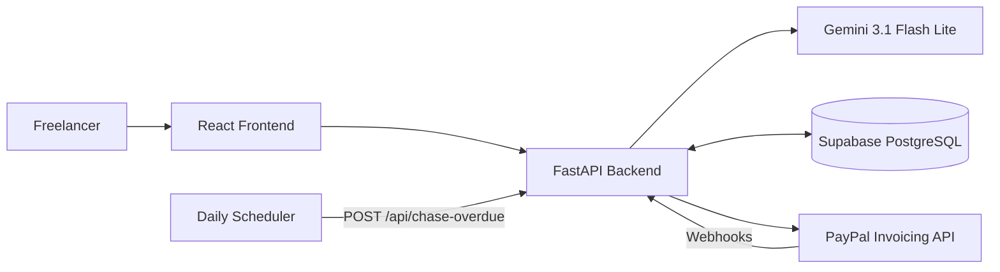

# BahiKhata — The AI Invoicing Assistant

**Turn client notes into invoices. Track payments. Follow up automatically.**

BahiKhata is an AI-powered invoicing assistant designed to help freelancers and small businesses create PayPal invoices from natural-language notes, track payment status, and follow up on overdue invoices with AI-assisted reminders.

Built by Anurag Shukla for the PayPal AI Hackathon.

## ✨ Features

* **AI-Powered Invoice Creation:** Convert natural-language client notes into structured invoice details using Google Gemini.
* **PayPal Invoicing:** Create invoice drafts and send invoices through the PayPal Invoicing API.
* **Invoice Ledger:** View invoices and track their payment status from a centralized dashboard.
* **Payment Tracking:** Process PayPal webhooks to synchronize invoice statuses.
* **AI-Assisted Reminders:** Generate payment reminder messages based on how overdue an invoice is.
* **Automated Follow-Ups:** Process overdue invoices with configurable reminder intervals and limits.
* **Tax Support:** Specify tax rates and tax labels for invoice line items.
* **Responsive Interface:** Manage invoices through a modern React-based web application.

## 🛠️ Technology Stack

| Component          | Technology                   |
| ------------------ | ---------------------------- |
| Frontend           | React, Vite, Tailwind CSS    |
| Invoice Ledger     | AG Grid                      |
| Backend            | Python, FastAPI              |
| AI Model           | Google Gemini 3.1 Flash Lite |
| Database           | Supabase PostgreSQL          |
| Payment Processing | PayPal Invoicing API         |
| Deployment         | Vercel and Render            |

## 🏗️ Architecture



## 📁 Project Structure

```text
BahiKhata/
├── backend/
│   ├── main.py
│   ├── test_main.py
│   ├── requirements.txt
│   └── .env.example
├── frontend/
│   ├── src/
│   ├── public/
│   ├── package.json
│   └── ui.test.jsx
├── schema.sql
├── render.yaml
└── README.md
```

## 🚀 Getting Started

### Prerequisites

* Python 3.11 or newer
* Node.js 18 or newer
* A Supabase account
* A PayPal Developer account
* An API key for Google Gemini

### 1. Configure Supabase

1. Create a Supabase project.
2. Open the SQL Editor in your project dashboard.
3. Execute the SQL statements in `schema.sql`.
4. Obtain your project URL and the required service key from the project settings.

**Security:** Keep your service key private. Never expose it in frontend code or commit it to a public repository.

### 2. Configure PayPal Sandbox

1. Open the PayPal Developer Dashboard.
2. Create a sandbox application.
3. Copy the sandbox client ID and secret.
4. Keep these credentials for the backend configuration.

### 3. Configure the Backend

From the project root, open a terminal and run:

```bash
cd backend
python -m venv .venv
```

Activate the virtual environment.

**Windows PowerShell:**

```powershell
.venv\Scripts\Activate.ps1
```

**Linux/macOS:**

```bash
source .venv/bin/activate
```

Install the dependencies:

```bash
python -m pip install -r requirements.txt
```

Create your environment file.

**Windows PowerShell:**

```powershell
Copy-Item .env.example .env
```

**Linux/macOS:**

```bash
cp .env.example .env
```

Populate `.env` using the variable names in `backend/.env.example`. Configure the required Gemini API key, Supabase credentials, PayPal sandbox credentials, frontend origin, and cron secret.

Start the backend:

```bash
uvicorn main:app --reload
```

The API should be available at:

`http://localhost:8000`

### 4. Configure the Frontend

Open a second terminal from the project root:

```bash
cd frontend
npm install
npm run dev
```

Open the development URL printed by Vite, typically:

`http://localhost:5173`

Ensure the frontend's API configuration points to the local FastAPI backend.

### 5. Configure PayPal Webhooks

PayPal requires a publicly accessible webhook endpoint.

1. Deploy the backend or expose it through a secure development tunnel.
2. Open your PayPal sandbox application.
3. Register the public endpoint ending in `/webhooks/paypal`.
4. Subscribe to the invoice events supported by the backend.
5. Configure the resulting webhook ID in the backend environment.

**Important:** Keep webhook signature verification enabled in deployed environments. Any verification bypass should be restricted to controlled local testing.

## 💡 Using BahiKhata

### Create an Invoice

1. Open the application.
2. Enter natural-language notes describing the client, work performed, pricing, taxes, and payment deadline.
3. Use the AI parsing feature to extract the invoice details.
4. Review the generated information and correct anything necessary.
5. Create the invoice draft through PayPal.
6. Send the invoice to your client.

Example input:

```text
Brand identity for Meera Shah (meera@studiokora.in),
3 days at 8000 a day, plus 2500 for print files.
18% GST, due in 15 days.
```

### Track Payments

1. Open the invoice ledger.
2. Review invoice details and payment statuses.
3. Complete a payment using a PayPal sandbox buyer account.
4. Verify that the corresponding webhook updates the invoice status.

### Send Payment Reminders

1. Select an eligible overdue invoice.
2. Generate a payment reminder.
3. Review and edit the reminder message.
4. Send it through PayPal.

For testing automated reminders, use a sandbox invoice with an appropriate overdue date.

## 🔔 Automated Overdue Follow-Ups

BahiKhata provides the following endpoint for processing overdue invoices:

`POST /api/chase-overdue`

The backend supports configurable reminder intervals, reminder limits, escalation based on lateness, and protection against duplicate sends.

The endpoint requires the `x-cron-secret` header to match the configured `CRON_SECRET`.

Example:

```bash
curl -X POST \
  -H "x-cron-secret: YOUR_CRON_SECRET" \
  https://YOUR-API-URL/api/chase-overdue
```

A trusted scheduler can call this endpoint periodically. Configure the schedule and timeout according to your hosting environment.

## 🔌 API Reference

| Endpoint                           | Description                                                    |
| ---------------------------------- | -------------------------------------------------------------- |
| `POST /api/parse`                  | Convert natural-language notes into structured invoice details |
| `POST /api/invoices`               | Validate and create an invoice                                 |
| `POST /api/invoices/{id}/send`     | Send an invoice through PayPal                                 |
| `GET /api/invoices`                | Retrieve invoices and payment information                      |
| `POST /webhooks/paypal`            | Process PayPal invoice events                                  |
| `POST /api/invoices/{id}/followup` | Generate an AI-assisted payment reminder                       |
| `POST /api/invoices/{id}/remind`   | Send a reminder through PayPal                                 |
| `POST /api/chase-overdue`          | Process overdue invoices for automated follow-up               |

## 🧪 Testing

### Backend Tests

From the project root, activate your virtual environment and run:

```bash
python -m pytest backend/test_main.py -v
```

### Frontend Tests

Run the test command configured in `frontend/package.json`.

The repository includes automated tests for invoice validation, payment status handling, webhook processing, reminder behavior, tax calculations, and other application workflows.

Test results depend on environment configuration and mocked integrations. Passing automated tests alone does not guarantee that every live integration has been verified.

## 🌐 Deployment

The frontend and backend can be deployed separately.

Before deploying:

1. Configure the required environment variables in the hosting provider.
2. Set the frontend API URL to the deployed backend.
3. Configure the backend's allowed frontend origins.
4. Register the deployed webhook URL in the PayPal application.
5. Keep webhook signature verification enabled.
6. Test invoice creation, sending, payment updates, and reminders using the sandbox.

For custom domains, follow your hosting provider's DNS instructions and verify HTTPS before sharing the application.

## ⚠️ Known Limitations

* **Authentication:** If authentication is not enabled, application data may be accessible to other visitors. Access controls should be implemented and verified before handling confidential customer information.
* **Sandbox Payments:** Sandbox credentials are intended for testing. Live transactions require appropriate PayPal live credentials and configuration.
* **Tax Compliance:** Tax rates and labels are invoice inputs. Users are responsible for determining the applicable tax treatment.
* **Legal Documents:** Privacy and terms pages should be reviewed before the application is used with real customers.
* **AI Accuracy:** Generated invoice details and reminders should be reviewed before they are sent to clients.

## 🤖 AI Disclosure

BahiKhata uses **Google Gemini 3.1 Flash Lite** to interpret natural-language invoice notes and assist with payment reminder generation.

AI-generated information is presented for user review before invoices and reminders are sent.

## 📄 License

See the repository's `LICENSE` file for the applicable open-source license.
 